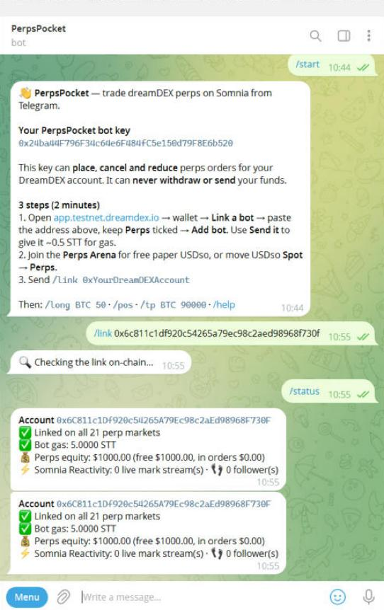
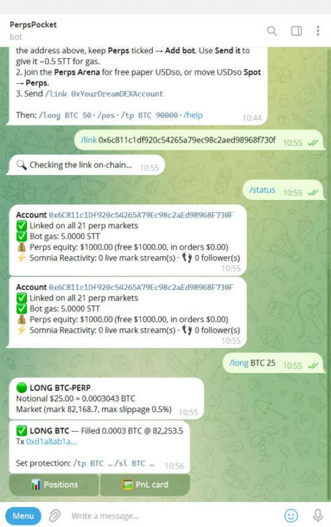
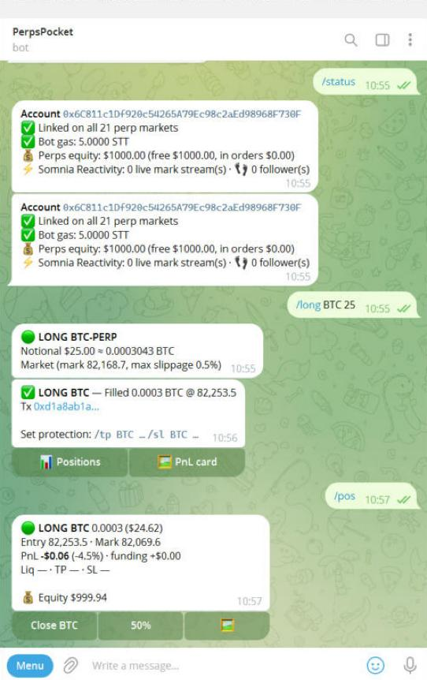
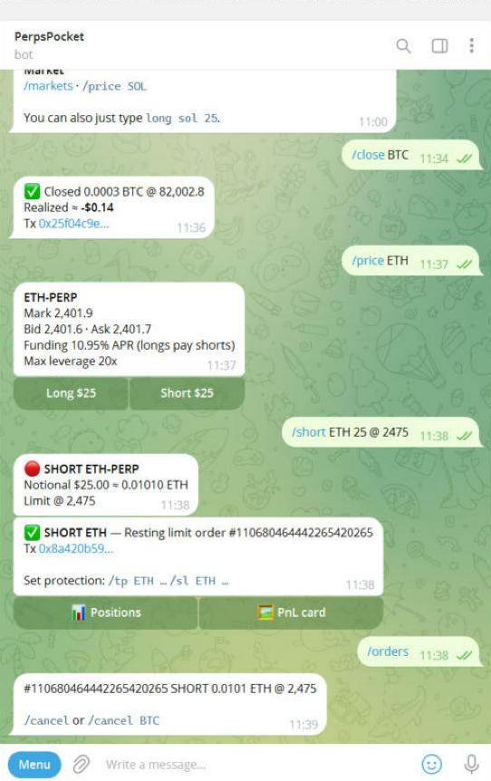
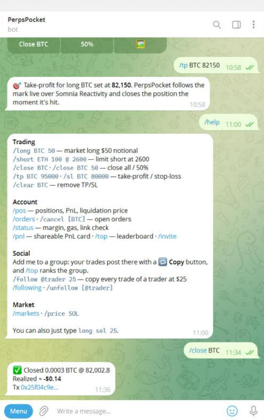
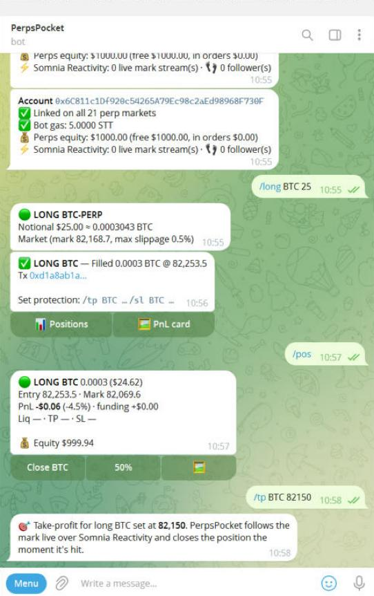
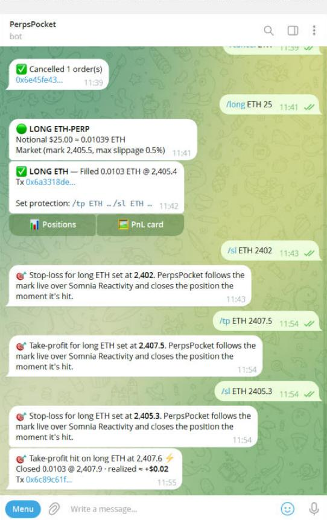

# PerpsPocket

**Trade dreamDEX perps on Somnia from Telegram, with a bot key that can never withdraw your funds.**

PerpsPocket is a Telegram bot for the dreamDEX perpetual futures on Somnia Tokyo testnet (Hideki, chain 50383). You type `/long BTC 50` and get a filled order with an explorer link. Your take-profit and stop-loss react to the mark the moment Somnia Reactivity pushes it. The bot alerts you before liquidation and makes a shareable PnL card you can post.

**What makes it different: perps are social here.** Add the bot to any Telegram group and every trade a member makes posts there with a **🔁 Copy** button. Anyone can mirror it at the same size with one tap, on their own account. Or they can `/follow` the trader so every open and close is copied automatically. Each group gets its own leaderboard.

Built for the [dreamDEX Perps Builder Bounty](https://dorahacks.io/hackathon/dreamdex-perps-bounty/detail), MVP track (category: bots and agents / consumer perps). The `feedback/` folder has the Feedback-track reports found while building it.

## Who it's for

- **Mobile and casual traders.** They want to open, check and close a perp in two taps, without a desktop trading UI or a browser wallet popup.
- **Active traders.** They need TP/SL that survives a closed laptop and a ping before liquidation.
- **Groups and communities.** PnL cards and a weekly leaderboard turn trades into posts. Each card carries the trader's invite link, which brings in the next trader.

## Why it's safe: the linked bot key

PerpsPocket never asks for your wallet's private key or seed phrase.

1. `/start` generates a **fresh key just for you** and stores it encrypted (AES-256-GCM).
2. You link that key's address to your DreamDEX account in the app (**wallet → Link a bot → Perps**).
3. The link is an on-chain operator grant for three functions on the perp pools: `placeOrderFor`, `cancelOrderFor` and `reduceOrderFor`. The key **cannot withdraw, transfer or change your settings**. You can unlink it in the app at any time.

The bot checks the grant on-chain for every market (`isOperatorAuthorized`) before it trades, and `/status` shows the result.

## Features

| Command | What it does |
| --- | --- |
| `/long BTC 50`, `/short ETH 100 @ 2600` | Market or limit order by USDso notional. Shows a preview and a confirm button, then the fill price and a tx link |
| `long sol 25` | The same in plain text, no slash needed |
| `/pos` | Positions with entry, mark, PnL net of funding, ROE, **liquidation price**, TP/SL, and one-tap close buttons |
| `/close BTC [50]` | Closes all or a percentage with a reducing IOC, aligned to the lot grid. Shows realized PnL |
| `/tp BTC 95000`, `/sl BTC 80000` | Bot-side take-profit and stop-loss, fired by **Somnia Reactivity** mark pushes, with a 15 s poll as fallback. A stop past the liquidation price is refused |
| **group trading** | In a group, each member's trade posts with **🔁 Copy $25** and **👣 Follow** buttons. Copy previews the same order for the person who tapped it, on their own account |
| `/follow @trader 25`, `/following`, `/unfollow` | Copy-trading: every open of the trader is mirrored at your size, and every full close (manual, TP or SL) closes yours |
| `/top` in a group | The group's own weekly leaderboard, with Follow buttons for the top 3 |
| liquidation alert | A push when the mark gets within 5% of the liquidation price, with *Close 50% / Close all* buttons |
| `/pnl` | PnL card image with your invite link, ready to post |
| `/top`, `/invite` | Weekly realized-PnL leaderboard and referral link |
| `/markets`, `/price SOL` | All 21 perp markets: mark, bid and ask, funding APR, max leverage |
| `/status` | Link coverage per market, bot gas (STT), perps equity |

Why bot-side TP/SL: a linked operator key cannot arm the protocol's stop orders, because only the account itself can. PerpsPocket watches the mark and closes with a reducing IOC when a trigger is crossed.

## How it works

```
Telegram ─► grammy bot (src/bot.ts) ─► engine (src/engine.ts)
                                         │ reads: one shared SomniaMarkets client (markets-sdk 0.32.1),
                                         │        account passed explicitly per user
                                         │ sizing: getMaxPerpOrderSize (pool's own rule)
                                         │ writes: placeOrderFor / cancelOrderFor signed by the user's bot key
Somnia Reactivity (src/reactive.ts) ── somnia_watch on each pool ──► mark push ──► watcher (src/watcher.ts)
                                   eth_calls = [pool.tryGetMarkPrice()], push_changes_only    TP/SL fire at once
social (src/social.ts) ── after every fill ──► group posts with Copy / Follow, mirrored orders for followers
SQLite (node:sqlite): users, encrypted keys, trades with tx hashes, triggers, follows, group members
```

**Somnia Reactivity.** Every pool that carries an active TP/SL gets one `somnia_watch` subscription. Each log the pool emits arrives with `tryGetMarkPrice()` already evaluated at the same block, and `onlyPushChanges` drops pushes where the mark didn't move. Measured on Hideki: 38 pushes in 30 s on BTC-PERP and ETH-PERP (`npx tsx scripts/reactivity-probe.ts 30`). A per-key lock means a burst of pushes closes a position once. If a stream goes quiet for 20 s, the poll takes over.

**Copy-trading stays non-custodial.** A copied order is placed by the follower's own linked key for the follower's own account. Nobody's key can trade anyone else's funds.

- Sizing never happens locally. `getMaxPerpOrderSize` sizes against the pool's own rule, and it reports problems such as a voucher-blocked market before anything is sent.
- Prices and quantities are converted with each market's own decimals (6 to 24) and aligned to the tick and lot grid.
- Market orders cross the touch with configurable slippage (default 0.5%), so an IOC doesn't revert `ImmediateOrCancelNoFill` when the book moves.
- Close size comes from the on-chain position. PnL comes from `listPerpPositionAnalytics`, and liquidation price from `getLiquidationPrice`.
- No step can freeze the bot. Telegram updates run one at a time, so every chain read has a 30 s deadline, every write 90 s (its receipt wait is capped at 60 s and the hash is logged as soon as it is sent), and each handler 150 s. A watcher tick that overruns is cut off, so the TP/SL fallback keeps running. Each command logs its outcome and duration, and any step slower than 5 s is logged by name.
- `src/perp-core/` is vendored from the MIT-licensed [dreamdex-bot-kit](https://github.com/somnia-chain/dreamdex-bot-kit), with two changes: it uses the Hideki address set on Hideki (see `feedback/001`), and `operator.ts` bounds the receipt wait.

## Run it

Needs Node 22+ (it uses the built-in `node:sqlite`).

```bash
git clone https://github.com/kireev-duty/perpspocket && cd perpspocket
npm install
cp .env.example .env     # TELEGRAM_BOT_TOKEN from @BotFather, MASTER_KEY = 32+ random chars
npm run doctor           # read-only: lists every perp market, proves the SDK reaches Hideki
npm start                # starts the bot + the TP/SL watcher
```

Then in Telegram: `/start`, link the shown address in the app, send `/link 0xYourAccount`, then `/long BTC 25`.

Without Telegram, `npm run once -- BTC long 25` / `npm run once -- BTC close` / `npm run once -- status` trades through the same engine, using `PRIVATE_KEY` (a linked bot key) and `OWNER_ADDRESS` from `.env`. `npx tsx scripts/smoke.ts` runs every read path plus a refused order and renders a sample card.

## Live on Somnia Tokyo testnet

Placed from Telegram by the linked bot key `0x24ba…b520` for account `0x6C81…730F`.

| Action | Market | Fill | Tx |
| --- | --- | --- | --- |
| `/long BTC 25` → Confirm (market IOC via `placeOrderFor`) | BTC-PERP | 0.0003 BTC @ 82,253.5 | [0xd1a8ab1a…94b0](https://explorer.testnet.somnia.network/tokyo/tx/0xd1a8ab1a5a77e76d212b40ea4e4303f2cdd5b8d8cfdd0d1060547389daa494b0) |
| `/close BTC` (reducing IOC), realized −$0.14 | BTC-PERP | 0.0003 BTC @ 82,002.8 | [0x25f04c9e…06d0](https://explorer.testnet.somnia.network/tokyo/tx/0x25f04c9e18dba28f2ec88a51586f0dc0bbb36ba5d561e8313e742c8be69f06d0) |
| `/short ETH 25 @ 2475` → Confirm (resting limit) | ETH-PERP | 0.0101 ETH @ 2,475, resting | [0x8a420b59…d63b](https://explorer.testnet.somnia.network/tokyo/tx/0x8a420b591b28acd600515da18e7adddee49a2a19b74fe6679096019db5dad63b) |
| `/cancel ETH` (`cancelOrderFor`) | ETH-PERP | order cancelled | [0x6e45fe43…1c2d](https://explorer.testnet.somnia.network/tokyo/tx/0x6e45fe43b2b314a7ff3da8d68f4223c4bb5527f0312413f57f82368849ed1c2d) |
| `/long ETH 25` → Confirm | ETH-PERP | 0.0103 ETH @ 2,405.42 | [0x6a3318de…261f](https://explorer.testnet.somnia.network/tokyo/tx/0x6a3318dedd293bcb7567bd042aa9e664ac4450711f034e6e632b6d7be480261f) |
| `/tp ETH 2407.5` fired on a Reactivity mark push (2,407.61), realized +$0.02 | ETH-PERP | 0.0103 ETH @ 2,407.86 | [0x6c89c61f…bd53](https://explorer.testnet.somnia.network/tokyo/tx/0x6c89c61fdf1504bb441153de26df4081f1809d62c27849b00c6005ece213bd53) |

The explorer shows the BTC fills as size 0, which is the bug in `feedback/009`.

## Screenshots

| Link and status | Order filled | Positions | Limit order and cancel |
| --- | --- | --- | --- |
|  |  |  |  |

| Close with realized PnL | TP/SL set | TP fired on Reactivity ⚡ |
| --- | --- | --- |
|  |  |  |

## X posts

- [Perps are better with friends: group trading with Copy and Follow](https://x.com/bratosabra/status/2113180781887754584)
- [TP/SL on Somnia Reactivity](https://x.com/bratosabra/status/2113180975559561249)
- [First live dreamDEX perp from Telegram, with the tx](https://x.com/bratosabra/status/2113181117389901839)

Correction to the Reactivity post, from [a reply in that thread](https://x.com/bratosabra/status/2113185342119375143): the mark is not pushed every block. Each event a pool emits triggers a `somnia_watch` push carrying the mark evaluated in that same block, about 38 pushes per 30 s on BTC and ETH in testing, and polling is only a fallback. The TP fill in the table above fired on one of these pushes.

## Feedback track

Each report in `feedback/` has steps to reproduce and evidence (tx hashes, page text or a script in `scripts/`).

| Report | Area | Status |
| --- | --- | --- |
| [004](feedback/004-hideki-addresses-missing-operator-registry.md): Hideki address set has no OperatorPermissionsRegistry | SDK | claimed |
| [008](feedback/008-docs-perp-gas-cost-understated.md): docs understate perp gas cost about tenfold | docs | claimed |
| [009](feedback/009-explorer-perp-trade-size-zero.md): explorer shows perp fills as size 0 below 18 decimals | app | claimed |
| [010](feedback/010-explorer-operator-methods-not-decoded.md): explorer doesn't decode `placeOrderFor` / `cancelOrderFor` | app | claimed |
| [001](feedback/001-bot-kit-shannon-addresses-on-hideki.md), [002](feedback/002-sdk-perps-doc-says-only-btc-eth.md), [003](feedback/003-sdk-no-operator-perp-writes.md), [005](feedback/005-docs-position-cap-is-not-a-tenth.md), [006](feedback/006-docs-paper-usdso-column-wrong.md), [007](feedback/007-docs-open-interest-caps-stale.md) | SDK, docs | duplicates, not claimed |

The six duplicates were found independently on 2026-10-21, but other builders reported the same issues a day earlier. Each file links the earlier report: [rohan911438/DreamDex-Findings](https://github.com/rohan911438/DreamDex-Findings/tree/main/feedback), and for 001 also [DanhCaTuanNgoc/lucid-perps](https://github.com/DanhCaTuanNgoc/lucid-perps/tree/main/feedback). They stay here as a record of the work.

## Roadmap

- Fill notifications for resting limit orders, from the same Somnia Reactivity pool subscriptions that drive TP/SL.
- Copy-trading limits: a max size per leader and a daily loss cap for followers.
- A Telegram Mini App for the order ticket and the positions view.
- Mainnet as soon as dreamDEX perps launch there.

## License

MIT. `src/perp-core/` © DreamDEX S.A. (MIT, see `src/perp-core/LICENSE-dreamdex-bot-kit`).
